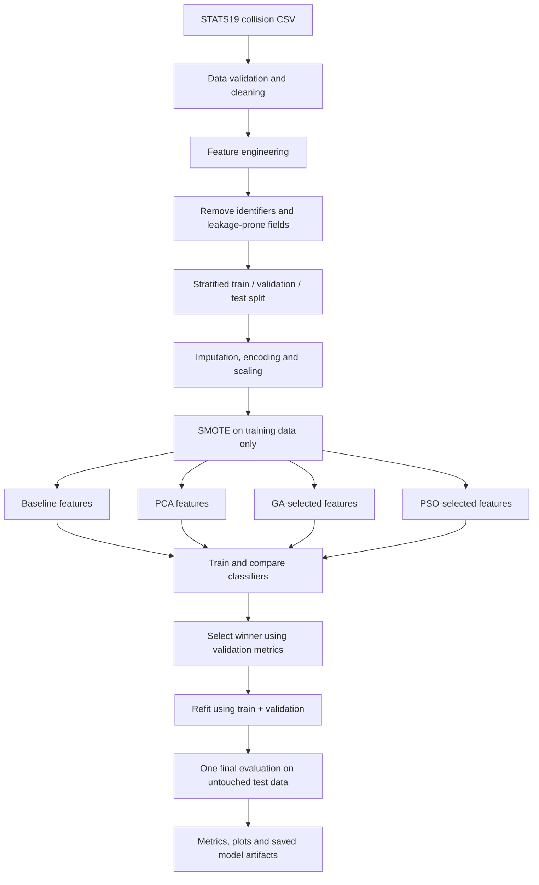

# Traffic-Accident-Severity-Prediction-ML
Road Accident Severity Prediction Using Machine Learning and Metaheuristic Feature Optimization
A multiclass machine-learning project that predicts the severity of road collisions in Great Britain using collision-context information from the UK Department for Transport (DfT) STATS19 Road Safety Open Data. The target is collision_severity, with three classes: Fatal, Serious, and Slight.

The project studies how different feature-representation strategies affect model performance. It compares a standard all-feature baseline with Principal Component Analysis (PCA), Genetic Algorithm (GA) feature selection, and Binary Particle Swarm Optimization (PSO) feature selection, then evaluates multiple classifiers under a consistent validation and test framework.
Project focus: This is a collision-severity classification task, not an accident-detection system. It estimates the severity class from available collision, road, and environmental context.

Table of Contents
- Problem Statement
- Dataset
- Project Workflow
- Feature Engineering
- Feature Representation Strategies
- Models Implemented
- Evaluation Strategy
- Project Structure
- Installation and Setup
- Running the Notebook
- Generated Outputs
- Reproducibility and Configuration
- Limitations and Future Improvements
- References
Problem Statement
Road collisions can result in injuries of very different severity. Understanding the factors associated with collision severity can support road-safety analysis and help identify patterns linked to more severe outcomes.

The objective of this project is to build and compare multiclass classification models that use collision-context attributes—such as road type, speed limit, junction information, lighting, weather, and road-surface conditions—to classify each record into one of three severity categories:
collision_severity	Class
1	Fatal
2	Serious
3	Slight

The class distribution is imbalanced, with Slight collisions forming the majority and Fatal collisions representing a much smaller class. For this reason, the project does not rely on accuracy alone. It gives particular attention to Macro-F1, Balanced Accuracy, and Fatal-class Recall.
Dataset
The project uses collision-level records from the UK Department for Transport's STATS19 road-safety data. The source contains collision circumstances and road/environmental context fields.

Official source: UK Department for Transport — Road Safety Open Data
Expected input
Place the selected CSV in the project root, alongside the notebook, using one of the filenames supported by the notebook:
- collision_detection_uk_transport.csv
- final_dataset.csv
- 5fb98e42-aeab-4f9d-9f4c-8161243c5bfc.csv
- data/collision_detection_uk_transport.csv
Important — check the dataset year before running: the current notebook searches for files in the order listed above. If both collision_detection_uk_transport.csv and final_dataset.csv are present in the project root, it selects collision_detection_uk_transport.csv first. In the supplied project files, these correspond to different annual extracts:
File	Year in the data	Shape
collision_detection_uk_transport.csv	2025	101,525 rows × 44 columns
final_dataset.csv	2023	104,258 rows × 44 columns

Keep only the intended input file in the project root, or change the order in INPUT_CANDIDATES in the notebook. The notebook's section headings and some plot labels currently say 2025; update those labels if you intentionally run the 2023 file. Do not combine annual extracts unless you deliberately want a multi-year experiment and have updated the experiment design accordingly.

The CSV is not embedded in this README. Add the dataset to your repository only if its redistribution terms permit it; otherwise, provide the official DfT source link and instructions for obtaining the required extract.
Project Workflow

The notebook is organized as an end-to-end workflow:
1. Data validation: load the CSV, validate the target classes, inspect missingness, and remove duplicate or invalid-target rows.
2. Cleaning: handle documented sentinel values, validate date/time fields, and prepare usable predictor columns.
3. Feature engineering: derive time-based, road-context, and environmental indicators.
4. Leakage control: remove identifiers, post-event fields, severity-derived fields, and fine-grained location identifiers that are not used in the chosen baseline.
5. Data splitting: create stratified training, validation, and test partitions in a 70% / 15% / 15% ratio.
6. Preprocessing: fit imputers, one-hot encoding, scaling, and constant-feature filtering on the training data, then apply the fitted transformations to validation and test data.
7. Class balancing: apply SMOTE only to the training partition. Validation and test data retain their original class distributions.
8. Feature experiments: construct Baseline, PCA, GA, and PSO feature representations.
9. Model comparison: train the classifier suite and compare results on validation data.
10. Final evaluation: select the best technique/model using validation results, refit it on training plus validation data, and evaluate the untouched test partition once.
Feature Engineering
The notebook creates additional predictors from the available collision context, including:
- Time: cyclical hour features (hour_sin, hour_cos), month, season, weekend indicator, and rush-hour indicator.
- Visibility and environment: dark-condition, adverse-weather, and adverse-road-surface indicators.
- Road context: speed-risk tier, motorway indicator, and junction-presence indicator.
Numeric variables are imputed using the median and scaled. Categorical variables are imputed using the most frequent value and one-hot encoded. Binary variables are imputed using the most frequent value.

To reduce target leakage, the notebook excludes fields such as collision identifiers, casualty count, severity-derived indicators, and post-event police-attendance information. It also excludes selected high-cardinality geographic identifiers and raw date/time columns after deriving time-based features.
Feature Representation Strategies
The same core classifier suite is evaluated using four feature representations.
Strategy	Description
Baseline	Uses all transformed features remaining after preprocessing and feature filtering. This acts as the reference experiment.
PCA	Compresses the transformed feature space into principal components. Candidate retained-variance levels are evaluated, and the setting is selected using validation Macro-F1.
Genetic Algorithm (GA)	Uses a binary feature mask evolved through selection, crossover, and mutation. A Random Forest wrapper evaluates each candidate subset using an inner training-only scoring split.
Binary Particle Swarm Optimization (PSO)	Uses binary particle positions to search for a high-performing feature subset, evaluated with the same wrapper-fitness function used by GA.

GA and PSO search settings
The current notebook uses the following starting budgets and settings:
Parameter	GA	Binary PSO
Population / swarm size	20	20
Maximum generations / iterations	100	100
Crossover probability	0.40	—
Mutation probability	0.01	—
Cognitive coefficient (c1)	—	1.5
Social coefficient (c2)	—	1.7
Early-stopping patience	12 generations	12 iterations

For feature search, the wrapper fitness is based on validation Macro-F1 from a small Random Forest, with a small penalty for selecting a larger feature subset. The search uses a stratified inner split from the training partition; the final test data are not used to select features.

The GA/PSO settings are literature-informed starting configurations adapted for this feature-selection experiment. They are not claimed to be universally optimal.
PSO-XGBoost hybrid
In addition to Binary PSO feature selection, the notebook includes a separate PSO-XGBoost experiment. This uses Particle Swarm Optimization to search XGBoost hyperparameters on an inner training-only holdout. It is a distinct experiment from selecting a feature subset with Binary PSO.
Models Implemented
The notebook benchmarks eight classifiers on each of the four feature representations:
1. Logistic Regression
2. Decision Tree
3. Random Forest
4. Extra Trees
5. HistGradientBoosting
6. AdaBoost
7. Multilayer Perceptron (MLP)
8. XGBoost
It also includes:
- Custom tabular 1D CNN: a PyTorch convolutional model with 32- and 64-filter convolution layers, batch normalization, ReLU activations, pooling, dropout, and a three-class output layer. In the currently saved notebook, the CNN is evaluated on the Baseline representation only. Since tabular columns do not naturally have spatial adjacency, this CNN is treated as an exploratory comparison rather than an assumed best model.
- PSO-XGBoost: an XGBoost model with hyperparameters optimized using a separate PSO search.
- Optional stacking ensemble: combines Random Forest, XGBoost, and MLP predictions with Logistic Regression as the meta-learner. It is disabled by default (RUN_STACKING = False) because it adds computational cost.
Evaluation Strategy
Data split and model selection
- Stratified 70% training / 15% validation / 15% test split.
- Random seed: 42.
- Preprocessing is fitted on the training partition only.
- SMOTE is applied to training data only; validation and test partitions remain unresampled.
- PCA, GA, PSO, and PSO-XGBoost search decisions are made without using the final test partition.
- The best technique/model combination is selected using validation results, prioritizing Macro-F1, then Balanced Accuracy, then Fatal Recall.
- The selected model is refitted using the combined training and validation data. The test set is evaluated once at the end.
Metrics and diagnostics
The notebook reports a range of metrics so performance on minority classes is visible:
- Accuracy
- Macro Precision, Macro Recall, and Macro-F1
- Weighted F1
- Balanced Accuracy
- Fatal-class Recall
- Multiclass one-vs-rest ROC-AUC
- Multiclass log loss
It also generates validation comparisons, ROC curves, learning/loss curves, a final-test confusion matrix, a final-test multiclass ROC plot, and a Fatal-class precision-recall curve. Feature importance is exported for supported tree-based winners, and SHAP analysis is attempted when enabled and supported by the selected model.

No performance score is hard-coded in this README. Run the notebook to obtain the metrics for the exact dataset file and configuration used in your experiment.
Project Structure
A simple GitHub repository can use the following layout:
road-accident-severity-prediction/
│
├── README.md
├── Traffic_Accident_Severity_Notebook.ipynb
├── collision_detection_uk_transport.csv   # or final_dataset.csv; use the intended year
│
└── traffic_severity_research_outputs/     # generated when the notebook runs
    ├── plots/
    └── models/
If you do not want to publish the raw CSV, omit it from the repository and follow the dataset instructions in the Dataset section. The notebook must still be able to find the CSV locally before it can run.
Installation and Setup
1. Clone the repository
git clone <your-repository-url>
cd road-accident-severity-prediction
2. Create and activate a Python environment
Windows (PowerShell or Anaconda Prompt):
python -m venv .venv
.venv\Scripts\activate
macOS / Linux:
python3 -m venv .venv
source .venv/bin/activate
3. Install dependencies
python -m pip install --upgrade pip
python -m pip install numpy pandas scipy scikit-learn imbalanced-learn xgboost matplotlib seaborn joblib threadpoolctl torch shap ipykernel notebook
The custom CNN uses PyTorch. The default torch installation can run on CPU. For GPU acceleration, install the PyTorch build that matches your CUDA setup using the official PyTorch installation guide.
Running the Notebook
1. Place the intended STATS19 CSV in the project root using one of the supported filenames listed in Dataset.
2. Confirm the selected input filename and year in notebook Section 1. Load the raw STATS19 dataset.
3. Launch Jupyter:
   jupyter notebook
   Or use JupyterLab:
   jupyter lab
4. Open Traffic_Accident_Severity_Notebook.ipynb.
5. Run the notebook from top to bottom. The notebook creates traffic_severity_research_outputs/ automatically and saves generated files there.
The complete experiment includes feature searches and multiple model fits, so it can take a while on a CPU-only machine. For a preliminary code check, reduce the search budgets in the configuration section. Use the full documented settings for the final experiment and report the settings actually used.
Generated Outputs
After a successful run, the notebook writes the following types of artifacts under traffic_severity_research_outputs/:
- Audits: raw-column audit, target distribution, missing-value handling, engineered-feature audit, column disposition, and split summaries.
- Feature experiments: PCA tuning results, GA/PSO selected-feature lists, feature-representation summary, and convergence plots.
- Model comparisons: validation leaderboard, per-model metrics, and ROC/loss plots.
- Final evaluation: final-test metrics, classification report, predicted classes and class probabilities, confusion matrix, ROC curve, and Fatal-class precision-recall curve.
- Explainability: feature-importance output and optional SHAP plots when supported.
- Saved artifacts: preprocessing components, selected model bundle (or CNN weights when the CNN is the selected model), and experiment_metadata.json.
Reproducibility and Configuration
The main configuration is in notebook Section 0. Install dependencies and configure the run. It includes:
- RANDOM_STATE = 42
- GA and PSO population sizes, iteration limits, and early-stopping settings
- PCA candidate variance thresholds
- PSO-XGBoost search budgets
- CNN maximum epochs, batch size, and early-stopping patience
- Optional switches for stacking, SHAP, and classical-model learning curves
Change these values only with a clear experimental reason, and record the final configuration alongside the results. Different hardware, package versions, dataset years, and search budgets can produce different results.
Limitations and Future Improvements
- Class imbalance: SMOTE is applied after one-hot encoding in the current pipeline. Standard SMOTE can create fractional values in one-hot columns. A separate SMOTENC or other mixed-data resampling experiment would be a useful comparison.
- Tabular CNN assumptions: a 1D CNN treats the ordered feature vector as a sequence, but ordinary tabular features do not have an inherent spatial order. CNN results should therefore be interpreted cautiously.
- Single-year random split: the current notebook uses a random stratified split within one annual extract. This does not establish how well the model generalizes to future years. A chronological multi-year train/test evaluation would be stronger.
- Heuristic search variability: GA and PSO are stochastic. Repeated runs with multiple random seeds would provide a better estimate of search stability.
- Research prototype: results are intended for academic experimentation and comparison. The notebook is not a deployed real-time traffic-safety or emergency-response system.
References
1. UK Department for Transport. Road Safety Open Data.
2. Assi, K. (2020). Traffic Crash Severity Prediction—A Synergy by Hybrid Principal Component Analysis and Machine Learning Models. International Journal of Environmental Research and Public Health, 17(20), 7598. https://doi.org/10.3390/ijerph17207598.
3. Zhong, W., & Du, L. (2023). Predicting Traffic Casualties Using Support Vector Machines with Heuristic Algorithms: A Study Based on Collision Data of Urban Roads. Sustainability, 15(4), 2944. https://doi.org/10.3390/su15042944.
4. Chen, F., et al. (2025). Traffic accident severity prediction based on an enhanced MSCPO-XGBoost hybrid model. Scientific Reports, 15, 25729. https://doi.org/10.1038/s41598-025-00797-7.
